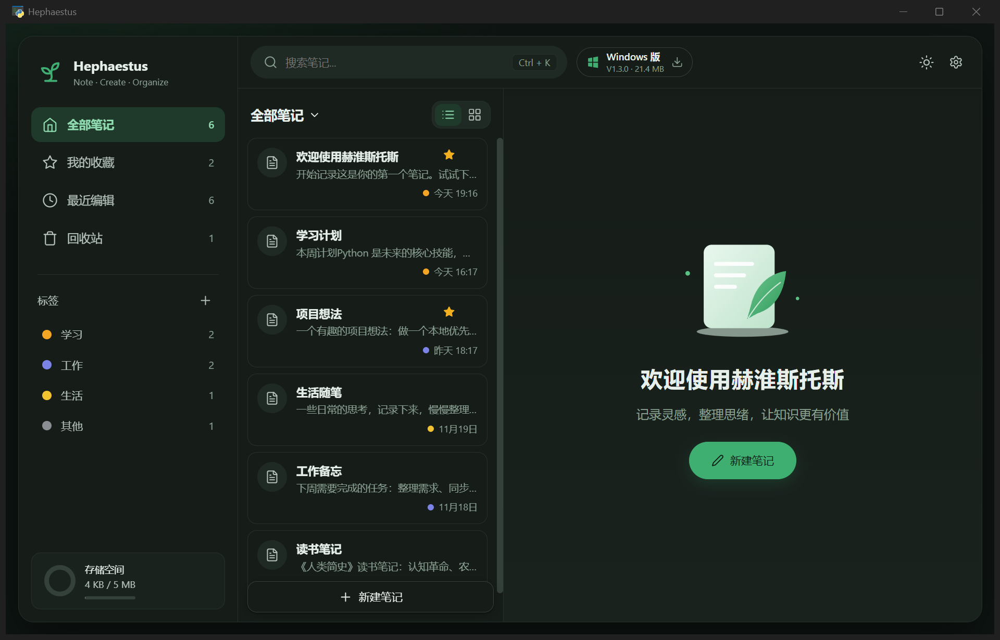

# Hephaestus

**本地优先的 Windows 笔记应用：数据只保存在你自己的电脑上。**

Hephaestus（赫淮斯托斯）是一个使用 Python、FastAPI、SQLite 和 pywebview 构建的本地笔记项目。它提供浏览器中的 Web 版，也提供无需浏览器、双击即用的 Windows 桌面版。笔记、标签和界面状态默认写入本机 SQLite 数据库，不上传云端。

[](https://github.com/jionbobby-commits/Hephaestus/actions/workflows/tests.yml)
[](https://github.com/jionbobby-commits/Hephaestus/releases)
[](https://www.python.org/)
[](https://github.com/jionbobby-commits/Hephaestus/releases)



## 目录

- [核心特色](#核心特色)
- [下载 Windows 桌面版](#下载-windows-桌面版)
- [Web 版使用](#web-版使用)
- [Windows 安装步骤](#windows-安装步骤)
- [主要功能](#主要功能)
- [技术架构](#技术架构)
- [数据存储与安全](#数据存储与安全)
- [备份、迁移与恢复](#备份迁移与恢复)
- [开发环境与本地运行](#开发环境与本地运行)
- [测试](#测试)
- [项目目录结构](#项目目录结构)
- [常见问题](#常见问题)
- [版本更新记录](#版本更新记录)
- [许可证](#许可证)
- [开发协作与致谢](#开发协作与致谢)

## 核心特色

- **本地优先**：默认使用本机 SQLite，不依赖云服务，不需要注册账号。
- **两种形态**：同一套前端既能在浏览器中运行，也能封装为独立 Windows 桌面窗口。
- **桌面体验**：V1.3.0 固定应用外壳，只有笔记列表和编辑区内部滚动，页面整体不随滚轮移动。
- **完整笔记操作**：创建、编辑、搜索、分类、标签、收藏、回收站、导入导出。
- **可离线使用**：安装桌面版后无需浏览器和网络；首次安装只需要系统具备 WebView2 Runtime。
- **可验证的构建**：提供 Inno Setup 安装包、便携版 ZIP、单文件 EXE 和 SHA256 校验值。

## 下载 Windows 桌面版

> **Windows 桌面版，下载安装后即可离线使用。** 数据保存在本机，不需要安装 Python。

[**下载 Hephaestus-Setup-1.3.0.exe**](https://github.com/jionbobby-commits/Hephaestus/releases/download/v1.3.0/Hephaestus-Setup-1.3.0.exe)

| 文件 | 大小 | SHA256 |
|---|---:|---|
| Hephaestus-Setup-1.3.0.exe（推荐） | 22,441,960 字节（21.4 MB） | 675FC8F8BD935BB9CF4C0C94D4A1B1057A44C1328F2165518CCE7631CD0B2D59 |
| Hephaestus-Portable-1.3.0.zip | 24,206,470 字节（23.1 MB） | B3D5E5AF32B8D07BA6CB99B01C0FA712ABD0454669C0F7CA6555287708A1CB82 |
| Hephaestus-1.3.0-onefile.exe | 24,314,848 字节（23.2 MB） | 5EB6B93DCC090511CBD9C3341095FA7A6DFAFB50C8B0B4072AE38C0A20DBA8F3 |

安装包、便携版和单文件版都来自同一份 V1.3.0 源码构建。完整校验值也见 [Release 页面](https://github.com/jionbobby-commits/Hephaestus/releases/tag/v1.3.0) 和 [SHA256SUMS.txt](https://github.com/jionbobby-commits/Hephaestus/releases/download/v1.3.0/SHA256SUMS.txt)。

**系统要求**：Windows 10/11 x64；Microsoft Edge WebView2 Runtime（Windows 11 通常已内置，Windows 10 如缺失会提示官方安装地址）；约 100 MB 磁盘空间。安装程序本身不要求管理员权限。

## Web 版使用

Web 版适合在本机浏览器中使用，也便于开发调试。

```powershell
python -m venv .venv
.venv\Scripts\Activate.ps1
python -m pip install -r requirements.txt
python -m uvicorn app.main:app --reload
```

打开 http://127.0.0.1:8000 。接口文档位于 http://127.0.0.1:8000/docs 。

Web 模式默认把数据库放在项目下的 data/hephaestus.db；桌面模式使用 %LOCALAPPDATA%\Hephaestus\hephaestus.db，两者互不覆盖。可以通过环境变量 HEPHAESTUS_DATABASE_URL 指定其他 SQLite 地址。

网页右上角的「Windows 版」入口会读取 /api/release 中的版本和大小，并跳转到对应的 GitHub Release 安装包；桌面窗口会自动隐藏这个入口。

## Windows 安装步骤

1. 从 [Release 页面](https://github.com/jionbobby-commits/Hephaestus/releases/tag/v1.3.0) 下载 Hephaestus-Setup-1.3.0.exe。
2. 双击安装包。安装程序默认按当前用户安装到 %LOCALAPPDATA%\Programs\Hephaestus，无需管理员权限。
3. 选择是否创建桌面快捷方式；开始菜单会创建「Hephaestus」入口。
4. 安装完成后启动 Hephaestus。首次启动会在 %LOCALAPPDATA%\Hephaestus 创建数据库和日志目录。
5. 如果系统缺少 WebView2 Runtime，程序会显示中文提示并给出微软官方下载地址，不会静默退出。

静默安装示例：

```powershell
Hephaestus-Setup-1.3.0.exe /VERYSILENT /SUPPRESSMSGBOXES /NORESTART /SP- /DIR="D:\Apps\Hephaestus" /TASKS=""
```

**升级**：直接运行新版本安装包覆盖安装即可。安装程序使用固定 AppId，程序文件被替换，%LOCALAPPDATA%\Hephaestus 中的数据库不会被覆盖。

**卸载**：从「设置 → 应用」或开始菜单卸载。卸载默认保留用户数据库和日志；如需彻底清理，请在确认已备份后手动删除 %LOCALAPPDATA%\Hephaestus。

更完整的安装、升级、备份和故障排查说明见 [docs/windows-desktop.md](docs/windows-desktop.md)。

## 主要功能

| 功能 | 说明 |
|---|---|
| 笔记管理 | 新建、编辑、删除、恢复；列表与网格视图 |
| 富文本编辑 | 标题、加粗、斜体、下划线、删除线、链接、图片、表格、列表、任务清单 |
| 搜索 | 按标题和正文关键词搜索；keyword 为新参数，q 兼容旧客户端 |
| 分类与标签 | 分类筛选、标签管理、标签颜色 |
| 收藏与回收站 | 收藏筛选、/notes/favorites、软删除与恢复 |
| 导入导出 | Markdown / TXT 导入，笔记导出 |
| 界面状态 | 深色/浅色主题、布局和排序等前端状态持久化到 SQLite |
| 桌面封装 | 独立窗口、自动端口、健康检查、优雅关停、单实例、WebView2 检测 |
| 数据兼容 | 旧版 SQLite 结构可直接读取；桌面模式可安全导入旧数据库并先备份 |

## 技术架构

```text
┌──────────────────────────────┐
│  static/ 原生 HTML/CSS/JS 前端 │
│  localStorage + /api/state     │
└──────────────┬───────────────┘
               │ HTTP (127.0.0.1)
┌──────────────▼───────────────┐
│  FastAPI (app/main.py)        │
│  routers/notes.py             │
│  routers/state.py             │
│  services/notes.py            │
└──────────────┬───────────────┘
               │ SQLAlchemy
┌──────────────▼───────────────┐
│  SQLite                       │
│  Web:    data/hephaestus.db   │
│  Desktop:%LOCALAPPDATA%\...   │
└──────────────────────────────┘

Windows 桌面版：
pywebview (WebView2) → 本地 FastAPI 服务 → SQLite
PyInstaller 打包为 onedir / onefile；Inno Setup 生成安装包
```

主要技术：

- 后端：Python 3.10+、FastAPI、Pydantic v2、SQLAlchemy 2、SQLite
- 前端：原生 HTML、CSS、JavaScript，无前端框架和构建步骤
- 桌面：pywebview 6、pythonnet、WebView2 Runtime
- 打包：PyInstaller 6（onedir / onefile）、Inno Setup 6
- 测试：pytest、httpx、FastAPI TestClient

## 数据存储与安全

**默认位置**

| 模式 | 数据库 | 其他文件 |
|---|---|---|
| Windows 桌面版 | %LOCALAPPDATA%\Hephaestus\hephaestus.db | logs\、config\、backups\ |
| Web 版 | data/hephaestus.db | 项目目录下 data\ |

- 数据库、日志和备份都在本机，不包含上传或云同步逻辑。
- 日志只记录启动、端口、健康检查和错误信息，不记录笔记正文。
- 桌面版只监听 127.0.0.1，不对外网开放。
- 当前版本是**单用户、单工作区**设计，没有登录、权限和多用户隔离。不要直接部署到公网。
- 安装包不包含数据库、个人笔记、日志、密钥或开发环境文件。

## 备份、迁移与恢复

**备份**

1. 退出 Hephaestus（关闭窗口，等待程序退出）。
2. 复制 %LOCALAPPDATA%\Hephaestus\hephaestus.db 到安全位置，文件名可加上日期。
3. 如需连同配置和日志一起备份，复制整个 %LOCALAPPDATA%\Hephaestus 目录。

**恢复**

1. 退出 Hephaestus。
2. 先把当前数据库另存一份，避免恢复失败时丢失现有数据。
3. 用备份文件覆盖 %LOCALAPPDATA%\Hephaestus\hephaestus.db。
4. 重新启动，确认笔记数量和内容。

**迁移到另一台电脑**：在新电脑安装同版本或更新版本，首次启动后退出，再用旧数据库覆盖新数据库；或者使用桌面版的 --import-db 参数导入旧库（会先写入 backups\ 备份，再校验并替换）。

**从 Web 版迁移到桌面版**：退出两个程序，把 data/hephaestus.db 复制为桌面数据库，或使用 --import-db。操作前请备份。

## 开发环境与本地运行

要求：Python 3.10+（本机验证使用 3.15.2），Windows 10/11；Web 版不需要 Node.js。

```powershell
git clone https://github.com/jionbobby-commits/Hephaestus.git
cd Hephaestus
python -m venv .venv
.venv\Scripts\Activate.ps1
python -m pip install -r requirements.txt

# Web 版
python -m uvicorn app.main:app --reload

# Windows 桌面版（源码运行）
.venv\Scripts\python.exe -m desktop.main
```

桌面版数据目录可通过 --data-dir 或 HEPHAESTUS_DATA_DIR 覆盖；--check-runtime 可检测 WebView2，--self-test 可输出 JSON 自检报告。详见 [docs/windows-desktop.md](docs/windows-desktop.md)。

构建 Windows 产物：

```powershell
# onedir
.venv\Scripts\pyinstaller.exe --noconfirm --clean build\Hephaestus.spec

# onefile
$env:HEPHAESTUS_ONEFILE="1"
.venv\Scripts\pyinstaller.exe --noconfirm --clean build\Hephaestus.spec
Remove-Item Env:HEPHAESTUS_ONEFILE

# Inno Setup 安装包（需先安装 Inno Setup 6）
& "$env:LOCALAPPDATA\Programs\Inno Setup 6\ISCC.exe" installer\Hephaestus.iss
```

## 测试

```powershell
.venv\Scripts\python.exe -m pytest -q
```

测试分为：

- tests/test_api.py：笔记 CRUD、PATCH、旧 PUT、keyword/q 搜索、分类/收藏筛选、参数校验、/api/state、发布信息与下载跳转。
- tests/test_desktop.py：桌面入口、数据目录、旧库导入、WebView2 检测、窗口启动参数。
- tests/test_healthcheck.py：健康检查、端口冲突、后端生命周期和误报回归。
- tests/test_installer.py：静默安装、快捷方式、启动、覆盖升级、卸载保留数据、重装读取旧数据。需要先构建 dist/Hephaestus 和 dist/installer/Hephaestus-Setup-<版本>.exe；缺少产物时自动跳过。

V1.3.0 本机执行结果见 [docs/release-notes-1.3.0.md](docs/release-notes-1.3.0.md)。

## 项目目录结构

```text
app/
  main.py            # FastAPI 入口、静态文件、/health、/api/release
  database.py        # SQLAlchemy 连接与会话
  models.py          # Note / FrontendState 模型
  schemas.py         # Pydantic 请求/响应模型
  release.py         # 版本、Release 资源名、下载地址（单一版本配置）
  routers/           # notes.py、state.py
  services/          # notes.py 业务逻辑
static/
  index.html         # 页面结构
  style.css          # 深色/浅色主题、固定外壳与内部滚动
  script.js          # 本地优先状态、编辑器、下载入口
desktop/
  main.py            # 桌面入口、窗口、关闭时保存
  server.py          # 本地服务、自动端口、健康检查
  paths.py           # 数据目录
  runtime.py         # WebView2 检测与中文提示
  legacy.py          # 旧数据库备份、校验、导入
  single_instance.py # 单实例
  dialogs.py         # 原生提示框
  assets/            # 应用图标
build/
  Hephaestus.spec    # PyInstaller 配置
  version_info.txt   # EXE 版本资源
installer/
  Hephaestus.iss     # Inno Setup 脚本
  ChineseSimplified.isl
tests/
docs/
tools/
```

## 常见问题

**Q：双击没有窗口，怎么办？**
先运行 Hephaestus.exe --check-runtime 查看 WebView2 检测结果；再查看 %LOCALAPPDATA%\Hephaestus\logs\hephaestus-desktop.log。如果提示缺少 WebView2，请从微软官方页面安装后重试。

**Q：Windows 提示“未知发布者”或 SmartScreen 拦截？**
当前安装包未做代码签名，Windows 可能显示未知发布者。请核对下载页面的 SHA256 后再决定是否运行；不要从第三方站点下载。

**Q：安装后数据在哪里？卸载会删除吗？**
桌面版数据在 %LOCALAPPDATA%\Hephaestus。卸载程序只删除安装目录中的程序文件，默认保留数据库和日志。

**Q：Web 版和桌面版能共用数据吗？**
可以手动迁移，但不要同时让两个实例写同一个数据库。迁移前先退出程序并备份。

**Q：为什么整个页面不能滚动？**
这是 V1.3.0 的桌面布局设计：顶栏和侧栏固定，笔记列表与编辑区分别内部滚动。鼠标在列表上滚动列表，在正文上滚动正文。

**Q：端口被占用怎么办？**
桌面版会自动选择空闲端口；如果启动失败，日志会记录原因。Web 版可用 --port 指定其他端口。

**Q：支持多用户或公网部署吗？**
不支持。当前没有认证和用户隔离，只适合个人本机使用。

## 版本更新记录

- **V1.3.0**：固定桌面布局与内部滚动；新增 Web 页面 Windows 下载入口和 /api/release；完善 README、第三方声明、变更记录与发布材料。
- **V1.2.1**：修复启动后健康检查误报，增加健康检查回归测试；安装包、便携版和单文件版同步更新。
- **V1.2.0**：正式图标、WebView2 检测、版本资源、Inno Setup 安装包、便携版和单文件版。
- **V1.1.0**：Windows 桌面封装，本地数据目录、单实例、优雅关停和 PyInstaller 打包。
- **V1.0.0 / 早期版本**：FastAPI + SQLite 笔记 API、前端、pytest 与 GitHub Actions。

完整记录见 [CHANGELOG.md](CHANGELOG.md)。

## 许可证

本项目当前**尚未声明开源许可证**。在项目所有者确认许可证之前，代码版权归作者所有，不授予复制、修改或再分发许可；这不影响你从官方 Release 下载并使用 Windows 安装包。

第三方依赖继续遵循各自许可证。直接依赖和打包工具的来源、版本与许可证见 [THIRD-PARTY-NOTICES.md](THIRD-PARTY-NOTICES.md)。

## 开发协作与致谢

Hephaestus 是一个由个人发起并持续开发的本地优先笔记项目。

在项目规划、技术方案讨论、代码实现、问题排查、测试和文档完善过程中，开发者借助了 ChatGPT（OpenAI）和 DSH（DeepSeek Harness）的 AI 辅助能力：

- **ChatGPT（OpenAI）**：主要参与需求梳理、架构讨论、技术分析、问题诊断和开发规划。
- **DSH（DeepSeek Harness）**：主要参与代码分析、代码实现、项目修改、测试及开发流程执行。

AI 工具是开发辅助手段，不是法律意义上的作者、版权所有者或项目主体。项目的最终决策、代码审查、测试验收和发布责任由项目开发者承担。

感谢 OpenAI、DeepSeek 以及所有开源项目和开发者提供的技术、工具与社区支持。特别感谢 FastAPI、Pydantic、SQLAlchemy、pywebview、PyInstaller、Inno Setup 和 Python 社区。
